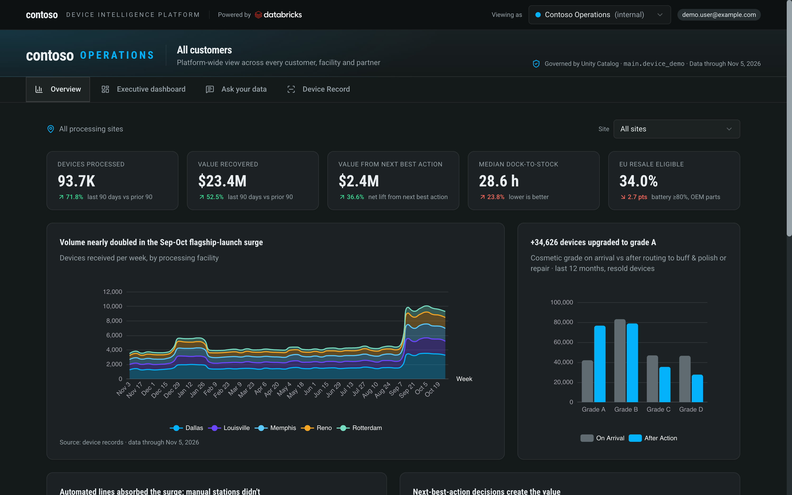
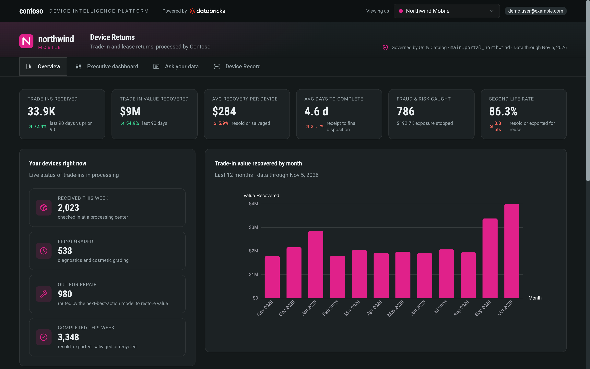
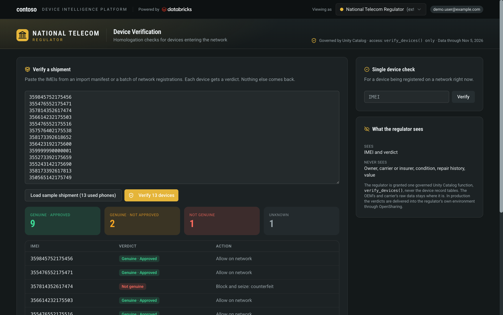
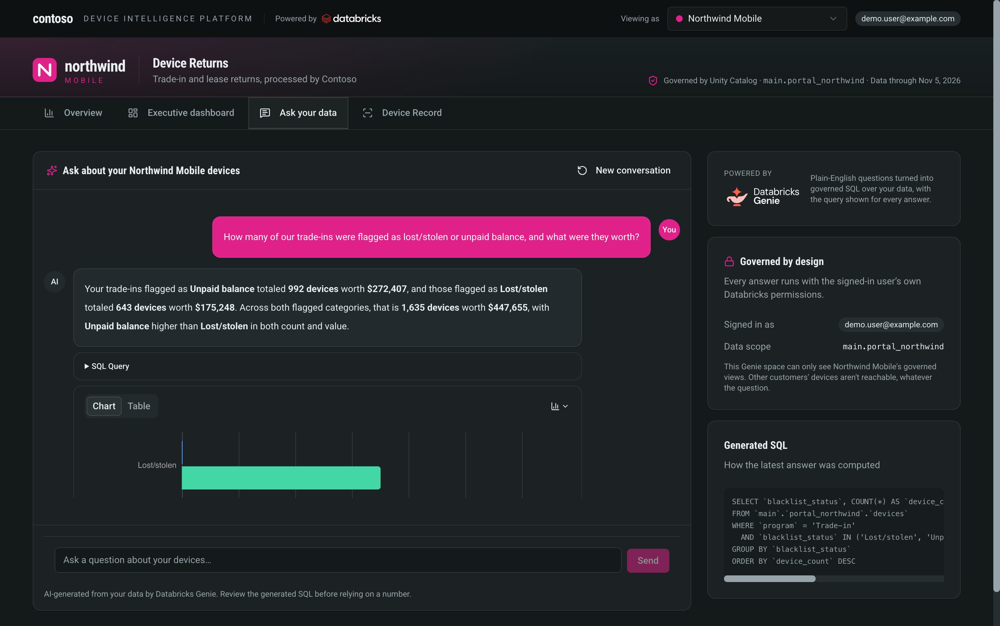
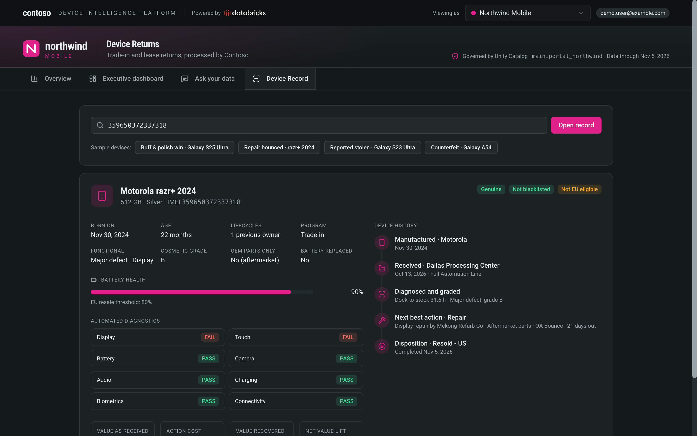
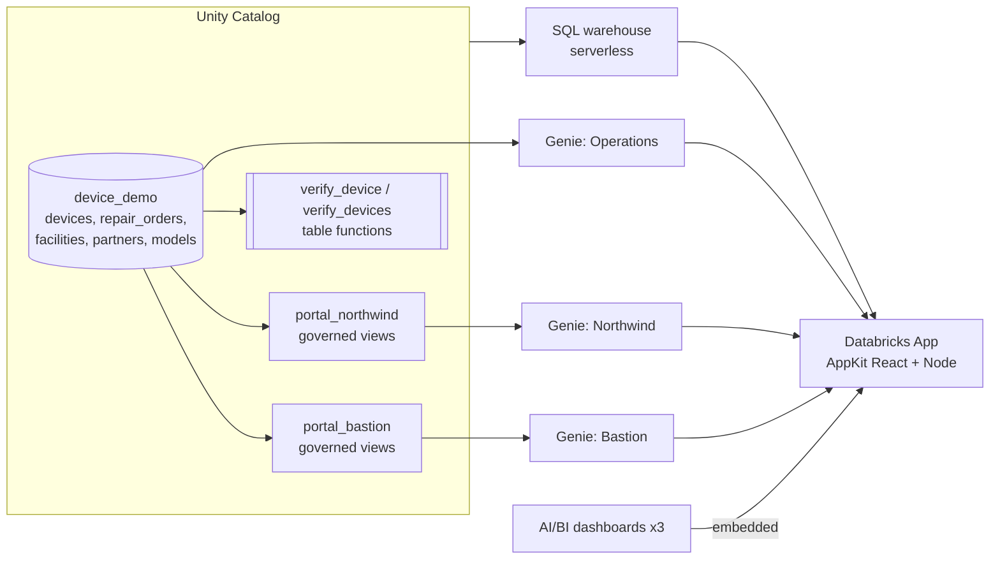

# Device Lifecycle Portal: white-labeled self-service analytics on Databricks

A demo for device lifecycle and reverse-logistics platforms (trade-in, insurance claims, warranty returns, refurb, resale) that want to give **every customer a branded, self-service analytics portal** and **share governed answers with outside parties** such as regulators, without building a report for each request.

One Databricks App, four personas, one copy of the data. **Unity Catalog** decides what each persona can reach.

| Viewing as | Who | What they get |
|---|---|---|
| **Contoso Operations** (internal) | The platform's own ops team | Network-wide KPIs, a site filter, dock-to-stock by automation level, next-best-action value, and a repair-partner scorecard with true cost per repair |
| **Northwind Mobile** (carrier) | A customer, white-labeled | Their own trade-in program: value recovered, days to complete, fraud caught before credit, second-life rate, devices in flight |
| **Bastion Protect** (insurer) | A customer, white-labeled | The same build with insurer wording: salvage value per claim, claim fraud caught before payout |
| **National Telecom Regulator** (external) | An outside party | Only an IMEI verification function: genuine / approved verdicts for a shipment. No access to device records |

All names are fictional and all data is synthetic (Contoso and Northwind are the usual Microsoft placeholder brands). Device models are real product names.



## What's in the app

- **Overview (native charts):** AppKit charts styled per tenant. Operations view has a site filter; customer views have customer-relevant KPIs only.
- **Executive dashboard (AI/BI, embedded):** a no-code AI/BI dashboard per persona with sparkline KPIs, an `AI_FORECAST` projection (Preview), a combo chart and a heatmap, embedded in the app.
- **Ask your data (Genie):** one Genie space per persona, each scoped to that persona's governed views. Shows the generated SQL and the signed-in user, and runs on behalf of the user.
- **Device record:** one governed record per device: identity, diagnostics, grading, battery, repairs, value and disposition.
- **Regulator view:** batch and single IMEI verification through a Unity Catalog table function (`verify_devices()`) that returns only the verdict.

| Customer view (white-labeled) | Regulator view |
|---|---|
|  |  |
|  |  |

## Architecture



- Customer personas read **views filtered to their own customer**, in their own schema. Their Genie space and dashboard only reference those views, so cross-customer access isn't possible from the question side.
- The regulator persona only calls a **table function** that returns IMEI + verdict. In production you would grant the regulator's identity `EXECUTE` on that function only, and deliver verdicts through OpenSharing.
- App analytics queries run as the app's service principal; Genie runs **on behalf of the signed-in user** (`user_api_scopes: dashboards.genie`).

## The data story

About 262K device records and 85K repair orders over 12 months (Nov 2025 to Nov 2026), generated in SQL with deterministic hashing (same rows every run). Built-in stories to find:

1. **Flagship-launch surge (Sep-Oct):** volume roughly doubles. Fully automated lines keep dock-to-stock near 18h; the manual site (Memphis) climbs from about 44h to 115h.
2. **The cheapest quote isn't the cheapest repair:** an overseas partner quotes about $40 per repair but switches to aftermarket screen parts in August. Bounce rate goes from about 5% to 20%, and its true cost per successful repair (repair + logistics + rework + value lost while out) reaches about $80, the highest of all partners.
3. **Buff & polish uplift:** grade B phones polished to grade A at sites with a polish cell. Memphis has none, so value is left on the table (Genie can quantify it).
4. **Battery and EU resale:** an older Galaxy S22 cohort fails the 80% battery threshold; aftermarket parts remove EU resale eligibility.
5. **Fraud and risk:** counterfeit, lost/stolen and unpaid-balance devices are quarantined, and the regulator view catches them in a shipment.

Details: [docs/data-model.md](docs/data-model.md).

## Quickstart

Prerequisites: Databricks CLI v1.0+ authenticated to a workspace with Unity Catalog, Databricks Apps and a serverless SQL warehouse (needed for `AI_FORECAST`); Node 20+; Python 3.10+.

```bash
# 1. Data, governed views, functions, Genie spaces, dashboards, app config (about 5 minutes)
python setup/setup.py build --profile <PROFILE> --catalog <CATALOG> --warehouse <WAREHOUSE_ID>
#    optional: --prefix demo_  to keep several copies apart in one catalog

# 2. Deploy the app
cd app && npm install && databricks apps deploy --profile <PROFILE>

# 3. Grant the app's service principal read access + allow the app domain for dashboard embedding
cd .. && python setup/setup.py grant --profile <PROFILE> --catalog <CATALOG> --app-name device-lifecycle-portal
```

The dashboard embed needs the workspace setting "AI/BI dashboard embedding" to allow approved domains; `grant` adds the app's domain to the list and keeps existing entries. Run locally with `cd app && npm run dev` (uses the `.env` written by setup).

## Demo flow (about 15 minutes)

1. **Operations view:** surge, dock-to-stock by automation level, set **Site = Memphis** (no buff & polish, no grade A uplift), the partner scorecard.
2. **Switch to Northwind Mobile:** same platform, white-labeled; their program KPIs and devices in flight. Flash **Bastion Protect** to show the insurer variant.
3. **Executive dashboard:** the same governed data in a no-code AI/BI dashboard, embedded, with the `AI_FORECAST` projection.
4. **Ask your data:** a suggested question; point at the generated SQL and the data scope.
5. **Device record**, then switch to the **Regulator**: load the sample shipment and verify 13 phones (9 approved, 2 blocked, 1 counterfeit, 1 unknown).

Full talk track and Q&A: [docs/demo-script.md](docs/demo-script.md).

## Make it yours

- **Brand:** `app/client/src/index.css` (theme tokens, fonts), `app/client/src/components/Logos.tsx` (platform and tenant marks), `app/client/src/tenants.ts` (names, accents, wording, suggested Genie questions).
- **Personas:** add a tenant in `tenants.ts`, a view schema in `setup/sql/11_tenant_views.sql`, and a space in `setup/build_spaces.py`.
- **Data:** the generator is plain SQL in `setup/sql/06_stage.sql`; distributions and story multipliers are at the top of each CTE.

## Repo layout

```
app/                     Databricks App (AppKit): client/, server/, config/queries/, databricks.yml, app.yaml
setup/setup.py           build (data, views, functions, Genie, dashboards, app config) and grant
setup/sql/               numbered SQL: dimensions, staged generation, final tables, comments, functions, views
setup/build_spaces.py    Genie spaces (instructions, example SQL, join specs, column descriptions)
setup/build_dashboards.py  AI/BI dashboards (sparkline counters, AI_FORECAST, combo, heatmap, dark theme)
docs/                    demo script, data model, screenshots
```

## Notes

- Feature maturity: `AI_FORECAST` is Preview. Dashboard embedding, Genie and Unity Catalog governance used here are generally available; check current status before customer-facing claims.
- Synthetic data only. No customer data, credentials or workspace identifiers are included; `setup.py` writes your workspace values into `app/client/src/config.generated.ts`, `app/databricks.yml`, `app/.env` (gitignored) and the query files.
